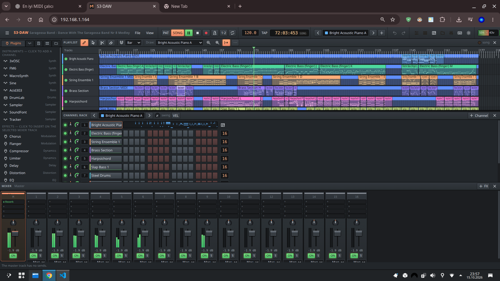

# Salty Loops

**A micro-DAW for ESP32-S3.**

Salty Loops runs its audio engine, instruments, effects and project storage on an ESP32-S3.
A browser provides the interface over Wi-Fi: a channel rack, piano roll, arranger, mixer and
plugin editors, with layouts for desktop. Multiple browsers can edit the
same project.



## Features

- **Sequencing:** channel rack and step sequencer, independent row lengths, swing, accents,
  probability and a piano roll with per-note controls.
- **Arrangement:** reusable patterns, playlist clips, markers, song loops and automation clips
  with editable curves.
- **Mixing:** master plus 16 mixer inserts, routing, four sends per insert and four effect slots
  per strip.
- **Built-in instruments:** Sine, 3xOSC, FM6, Acid303, MacroSynth and DrumLab, plus Sampler,
  SoundFont and Tracker.
- **Samples and SoundFonts:** WAV playback with loop, reverse, envelope and filter controls;
  SF2 bank/program selection and selective loading of the presets a project uses.
- **MIDI:** Web MIDI input, a Linux MIDI bridge, note recording, and Standard MIDI File
  format 0/1 import with tempo changes and supported expression/controller messages.
- **Tracker playback:** MOD, XM, S3M and IT import using libxmp; play a whole module or split
  its channels into groups for separate DAW mixing and effects.
- **Real-time effects:** Reverb, Delay, Chorus, Flanger, EQ, Filter, Compressor, Limiter,
  Distortion and Utility.
- **Projects and device controls:** on-device project slots and autosave, project file
  import/export, sample uploads, presets, diagnostics and browser firmware updates.
- **Plugin development:** a versioned C ABI, C++ helpers, a native test host and a plugin SDK
  for custom instruments and effects.
- **Native Linux host:** run the same portable audio core with ALSA or render a project to WAV.

## Current scope

This is a development project. Available polyphony and effects depend on the instruments,
samples and arrangement; the channel count is not a promise that every combination fits the CPU.
The normal hardware profile uses **240 MHz CPU, 44.1 kHz stereo audio and 256-frame blocks**.
Hardware measurements and their limits are recorded in [PERFORMANCE.md](esp32-s3-daw/docs/PERFORMANCE.md).

Tracker support provides **module playback, arrangement and mixing**. Editing a module's
internal notes, effect columns, samples or instruments, and exporting edited MOD/XM/S3M/IT
files, are future work. See [TRACKER.md](esp32-s3-daw/docs/TRACKER.md).

MIDI import applies supported messages and retains additional data; it does not provide full
GM/GS/XG/MT-32 device emulation. Manufacturer-specific sound editing and some controllers do
not have audible mappings. See [MIDI.md](esp32-s3-daw/docs/MIDI.md).

Plugins are compiled and linked **when building the firmware**. Runtime loading of arbitrary
plugin binaries is future work. The reference PCM5102A configuration is audio output only.

## Hardware

- ESP32-S3 with **16 MB octal PSRAM** and at least **16 MB flash**; the tested board has 32 MB
  octal flash. Select the flash size and mode that match your board.
- PCM5102A I2S DAC, USB power and a browser with Wi-Fi access to the device.
- The 16 MB partition layout reserves a 6 MiB sample library; the 32 MB layout reserves 22 MiB.
  Samples still need to fit the available RAM during playback.

Reference wiring, using the ESP32-S3's actual GPIO numbers:

| PCM5102A | Connection |
| --- | --- |
| BCK | GPIO16 |
| LCK / WS | GPIO6 |
| DIN | GPIO7 |
| VIN, XSMT | 3V3 |
| GND, SCK, FMT, FLT, DEMP | GND |

The reference adapter's printed pin labels differ from the ESP32-S3 GPIO numbers. Check your
board and DAC module before wiring; pin overrides are available in `config/local.env`.
See [HARDWARE_TESTS.md](esp32-s3-daw/docs/HARDWARE_TESTS.md) for the reference setup and validation status.

## Build

The repository includes both the DAW and plugin SDK. Commands below start at the repository root.

Requirements: Linux, Git, Python 3, C/C++ compilers, CMake, Ninja, Node.js **22.12+**, npm and
**ESP-IDF v5.5.5** with the ESP32-S3 toolchain. The Linux host also needs zlib development
headers; ALSA development headers enable live Linux audio. Firmware and plugin builds use
`IDF_PATH` from your ESP-IDF environment.

```sh
git clone https://github.com/smhgzll/esp32-salty-loops.git
cd esp32-salty-loops

# Use the location where you installed ESP-IDF.
export IDF_PATH="$HOME/esp/v5.5.5/esp-idf"
. "$IDF_PATH/export.sh"

# Build the 19 bundled instruments/effects from their sources and import them.
./scripts/build-plugins.sh
./esp32-s3-daw/scripts/build-web.sh
```

Prebuilt plugin packages, generated registries and build outputs are excluded from source
control. Re-run `scripts/build-plugins.sh` after changing plugin sources or the ABI.
The SDK also includes a plain-C tremolo example that can be built and imported separately.

On Fedora/Nobara, `esp32-s3-daw/scripts/bootstrap-nobara.sh` can install the development tools,
ESP-IDF and browser dependencies. On other distributions, install the equivalent packages
and follow the ESP-IDF setup instructions.

### Flash the ESP32-S3

```sh
cd esp32-s3-daw
cp config/local.env.example config/local.env
# Edit local.env: set your passwords, Wi-Fi mode, serial port and board-specific options.
scripts/build-hardware.sh
scripts/flash.sh --monitor
```

For 32 MB octal flash, set `DAW_FLASH_SIZE_MB=32` and `DAW_OCTAL_FLASH=1` in your local
configuration. A partition-table change requires USB flashing.

In AP mode, connect to the configured device network and open `http://192.168.4.1/`.
In STA mode, use the address printed on the serial console or `http://esp32daw.local/`
where mDNS is available. Local credentials and generated firmware stay outside Git.

### Run on Linux

After building the plugins and web UI above:

```sh
cd esp32-s3-daw
scripts/build-host.sh
build-host/bin/daw-host --web web/dist --audio alsa
# Open http://127.0.0.1:8080/
```

Offline demo rendering:

```sh
build-host/bin/daw-host --render out.wav --mode song --seconds 30
```

### Development checks

```sh
./esp32-daw-plugin-sdk/scripts/test-host.sh
./esp32-s3-daw/scripts/test-host.sh
cd esp32-s3-daw/web
npm test
npm run typecheck
```

Browser and optional QEMU tooling are documented in the component READMEs. Native tests and
emulation complement the hardware measurements; they do not establish analog audio quality
or long-duration device stability.

## Repository layout

| Directory | Contents |
| --- | --- |
| [esp32-s3-daw/](esp32-s3-daw/) | Firmware, portable audio engine, web UI, Linux host, tests and docs |
| [esp32-daw-plugin-sdk/](esp32-daw-plugin-sdk/) | Plugin ABI, instruments, effects, vendored DSP sources and SDK tools |
| [scripts/](scripts/) | Combined-repository build and source-preparation helpers |

## Documentation

- [DAW guide](esp32-s3-daw/README.md) · [Feature matrix](esp32-s3-daw/docs/DAW_FEATURES.md)
- [Architecture](esp32-s3-daw/docs/ARCHITECTURE.md) · [Audio engine](esp32-s3-daw/docs/AUDIO_ENGINE.md)
- [MIDI](esp32-s3-daw/docs/MIDI.md) · [Tracker modules](esp32-s3-daw/docs/TRACKER.md)
- [Plugin SDK](esp32-daw-plugin-sdk/README.md) · [Plugin integration](esp32-s3-daw/docs/PLUGIN_INTEGRATION.md)
- [Protocol](esp32-s3-daw/docs/PROTOCOL.md) · [Storage](esp32-s3-daw/docs/STORAGE.md)
- [Performance](esp32-s3-daw/docs/PERFORMANCE.md) · [Known issues](esp32-s3-daw/KNOWN_ISSUES.md)
- [MIDI examples and attribution](esp32-s3-daw/examples/midi/README.md)

## License

Copyright © 2026 [smhgzll](https://github.com/smhgzll).

The DAW firmware, web interface and Linux host are **GPL-3.0-or-later**; see [LICENSE](LICENSE).
The plugin SDK and bundled original plugins retain their **MIT** license; see
[esp32-daw-plugin-sdk/LICENSE](esp32-daw-plugin-sdk/LICENSE).
Third-party components retain their own licenses and notices; see [LICENSING.md](LICENSING.md).

User SoundFonts, tracker songs, ROMs and private projects are not bundled. Included example
resources are generated fixtures or have documented redistribution terms.
